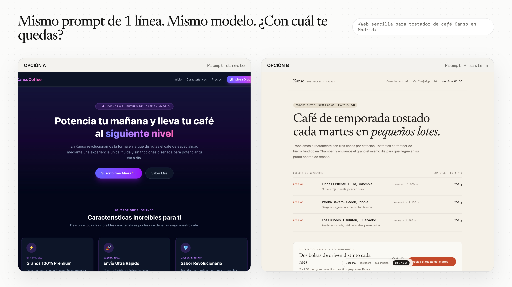

# forma (`forma.to`)

> **OpenRouter for Web Design.**  
> Connect Claude Code, Cursor, Codex, or Antigravity. Describe your project idea, cross-pollinate the world's sharpest web references into a deterministic 5-layer `DESIGN.md` + CSS/HTML structural scaffold, and ship with **0% AI slop**.


---

## Why `forma`?

Every web design directory on the internet (`Awwwards`, `Godly`, `Refs.Gallery`, `Mobbin`, `A1.gallery`, `DeadSimpleSites`, `Landings.dev`, `Rare UI`, `Minimal.gallery`) was built for **human eyes** (screenshots & videos), not for **AI coding agents**.

When you prompt an LLM to build a website without deterministic structural, typographic, and perceptual color constraints, it defaults to generic purple-indigo gradients, `01 //` fake eyebrows, layout-thrashing animations, and 3 identical Lucide icon cards.



**forma** turns taste into a machine-readable protocol inspired by [`treg.to`](https://treg.to), [`rareui.com`](https://www.rareui.com), [`pdepablo.com`](https://pdepablo.com), and [`resiz.es`](https://resiz.es):

- **340+ Indexed Design Assets**:
  - **30 Composable 5-Layer Formats** (*Surface*, *Typography*, *Layout*, *Primitives*, *Motion Physics*).
  - **73 Client-Rendered Playwright + Vision Section Blueprints** (`navbar`, `hero`, `bento-features`, `pricing`, `cta-footer`) cropped from 21+ flagship sites (`treg.to`, `resiz.es`, `pdepablo.com`, `rareui.com`, `coss.com`, `kokonutui.com`, `stripe.com`, `linear.app`, `vercel.com`, `attio.com`, `clerk.com`, `cal.com`, `resend.com`, `dub.co`, `raycast.com`) with **Clean Semantic DOM Skeletons**.
  - **18 Foundry Typography Pairings** across **Fontshare** (`Cabinet Grotesk + Satoshi`, `Clash Display + General Sans`, `Zodiak + Switzer`, `Sentient`, `Panchang`), **IBM Open Source** (`IBM Plex` triad), and **Google Variable** (`Newsreader`, `Instrument Serif`, `Fraunces`, `Bricolage Grotesque`, `Syne`, `Cormorant Garamond`) with zero-CLS `font-size-adjust: from-font`.
  - **6 Deterministic Structural CSS + HTML/TSX Scaffolds** injected directly into every `DESIGN.md` (`bottom-dock`, `split-product-frame`, `7/5 + 4/8 @container bento`, `tabbed-workflow-stage`, `tabular-3-tier-pricing`, `colophon-footer`) so the LLM never guesses layout geometry.
  - **24 Perceptual 60-30-10 `OKLCH` Color Systems** (Evil Martians Harmonizer, Radix Colors, Sanzo Wada, Happy Hues, Atmos) with verified WCAG AA/AAA contrast ratios.
  - **20 Interactive Registry Primitives** (`Rare UI`, `Kokonut UI`, `COSS UI`, `Cult UI`, `UILabs`, `Motion Primitives`, `Skiper UI`, `Vaul`, `cmdk`) + **124 Searchable Design Directories** + **36+ Continuously Scraped Live Websites**.
- **Standalone Open-Source Inspector ([`forma-xray` v1.2.0](https://github.com/josegaben/forma-xray))**: Extracts CSS custom properties, Fontshare/Google typography scales, `cubic-bezier` / `linear()` spring curves, live WAAPI scroll choreography (`--runtime`), Playwright section DOM skeletons (`--sections`), Gemini 4 Hydrogen Vision cataloging, and prepaid wallet management (`balance`, `topup`, `auth`).
- **Verified Core Web Vitals & GPU Discipline**: `CLS = 0.000`, `LCP < 100ms`, SSRF-hardened cloud endpoints, and `100% GPU-composited` (`transform` / `opacity`) animations enforced in CI.


---

## Connect Your Agent in 10 Seconds

### 1. One-Line Prompt (`llms.txt` & `llms-full.txt` — Zero Auth)
```text
set up forma - https://forma.to/llms.txt
```
- Compact routing index: `https://forma.to/llms.txt`
- Complete single-file inline specification (all 30 formats, 24 `OKLCH` palettes, 18 font `@import`s, and 6 CSS/HTML skeletons): `https://forma.to/llms-full.txt`

### 2. Install as an Agent Skill (`SKILL.md`)
```bash
npx skills add josegaben/forma
```

### 3. Streamable HTTP MCP Server (`15 Tools`) & 1-Click Cursor Install
```bash
claude mcp add --transport http forma https://forma-to.vercel.app/api/mcp
```

### 4. `shadcn/ui` Custom Registry & Figma W3C Design Tokens (`DTCG`)
```bash
# 1-Command install: injects OKLCH cssVars + writes DESIGN.md + TSX Bento/Hero scaffold:
npx shadcn@latest add "https://forma-to.vercel.app/r/forma-kit?surface=resizes-infra&palette=pal-carbon-halftone&font=pair-cabinet-satoshi"

# Export W3C Design Tokens JSON for Figma Variables / Tokens Studio / Penpot:
curl -fsSL "https://forma-to.vercel.app/api/tokens?surface=treg-gateway&palette=pal-stone-terracotta" > tokens.dtcg.json
```

**Available MCP Tools:**
| Tool | Description |
| :--- | :--- |
| `recommend_format_mix` | Cross-pollinates optimal 5-layer format IDs + 60-30-10 `OKLCH` palette from any natural-language brief (EN/ES). |
| `compose_design_spec` | Compiles a complete `DESIGN.md` with CSS tokens, optional `paletteId` & `fontPairingId`, 6 CSS/HTML/TSX skeletons, and pinned section DOM trees. |
| `get_structural_skeletons` | Fetches pure architectural CSS Grid, `@container`, and semantic HTML/TSX scaffolds (`01 Nav` → `06 Footer`). |
| `search_section_blueprints` | Queries 73+ real Playwright + Vision section blueprints (`hero`, `navbar`, `pricing`, `bento-features`, `cta-footer`). |
| `xray_live_website` | Live-scrapes any public URL to extract CSS custom properties, fonts, `cubic-bezier` curves, and Anti-Slop Craft Score. |
| `list_color_palettes` | Queries 24 curated 60-30-10 `OKLCH` palettes with verified WCAG contrast ratios. |
| `list_ui_components` | Searches 20 interactive Rare UI / Kokonut UI / COSS UI / Vaul / `shadcn` primitives with CLI install commands. |
| `list_web_formats` / `list_discovered_designs` / `list_craft_assets` | Explores 30 curated formats, continuously crawled gallery leaders, 18 typography pairings, and WebGL shaders. |
| `fetch_brand_svg` / `fetch_vector_icons` | Live-connected to **SVGL** (`450+` official brand SVGs) and **Iconify** (`18,000+` Phosphor/Tabler/Iconoir/Radix vectors) so agents never hallucinate SVG paths. |
| `get_shadcn_and_figma_exports` | Generates 1-command `npx shadcn@latest add` custom registry URLs and W3C DTCG Design Tokens JSON for Figma. |
| `check_forma_balance` / `get_unslop_checklist` | Inspects prepaid credit balance / BYOK status and mandatory `unslop-ui` subtractive rules. |

### 5. CLI & Multimodal Section Scanner (`forma-xray` v1.2.0)
```bash
# Fast zero-install DESIGN.md extraction (< 1s):
npx forma-xray https://resiz.es --out DESIGN.md

# Deep Playwright section crops + Clean Semantic DOM + Gemini 4 Vision:
GEMINI_API_KEY=... npx forma-xray https://cal.com --sections --out sections.json

# Check prepaid wallet ($1.00 free starter credit) & BYOK status:
npx forma-xray balance --endpoint https://forma.to
```

---

## Open Protocol + Prepaid Credits & BYOK (`treg.to` Model)

- **`$0.00` Open Protocol Forever**: `/llms.txt`, `/llms-full.txt`, `/skill.md`, `/api/compose`, 30 formats, 18 typography pairings, 6 structural skeletons, 24 `OKLCH` palettes, and all 73+ pre-indexed Section Vault blueprints are **100% free**.
- **`$0.00` Unmetered BYOK**: Pass your own `X-Gemini-Key` header (or run `forma-xray` locally) with **0% platform fee**.
- **Prepaid Cloud Credits (`/credits`)**: Zero subscriptions and zero seat fees. New accounts start with **$1.00 free credit** and a **$5.00/day runaway-agent safety cap** for on-demand cloud Playwright + Gemini Vision rendering (`$0.04/scan`).

---

## Key Platform Routes

- `/` — Visual Cross-Format Studio, Live Fontshare/Google Preview, Before/After A/B Benchmark (`EN`/`ES`), `⌘K` Command Explorer (`280+` items), 124 Live-X-Rayable Directories, and `#section-vault` (`73` real sections).
- `/demo/without-forma` vs. `/demo/with-forma` (and `/demo/en/...`) — Live side-by-side benchmark on an identical 17-word prompt (`forma-ab-demo.mp4` / `forma-ab-demo-en.mp4`).
- `/metrics` — Privacy-safe real-time Agent Pulls vs. Human Visits, Copy-to-Share K-factor, and Top Retaining Mixes telemetry dashboard (supports Upstash / Vercel KV via `KV_REST_API_URL` + `KV_REST_API_TOKEN`).
- `/credits` — Prepaid agent wallet, `sk-forma-...` token generator, `$5/$10/$25` top-up, and BYOK key manager.

---

## Run Locally

```bash
npm install
npm run dev -- -p 3030
```

```bash
npm run crawl          # Fast multi-gallery CSS & motion crawler
npm run crawl:visual   # Headless Playwright + Gemini Vision section blueprint crawler
npm run cwv:audit      # Chromium CLS = 0.000 & GPU-compositor verification
cd forma-xray && npm test
```

## License

MIT © [josegaben](https://github.com/josegaben)
